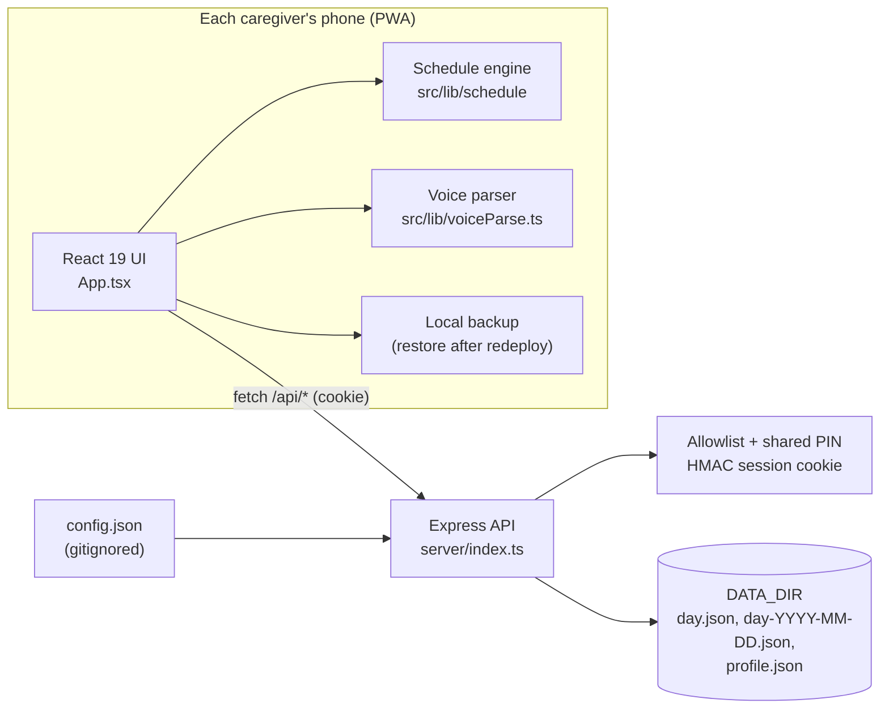
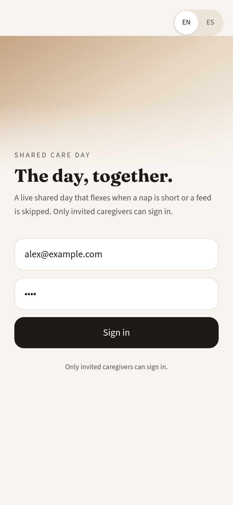
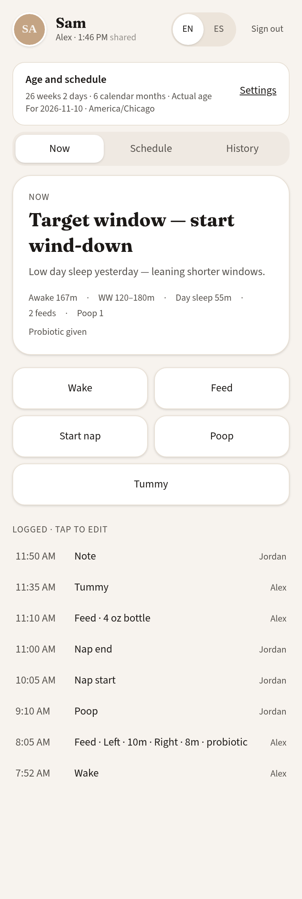
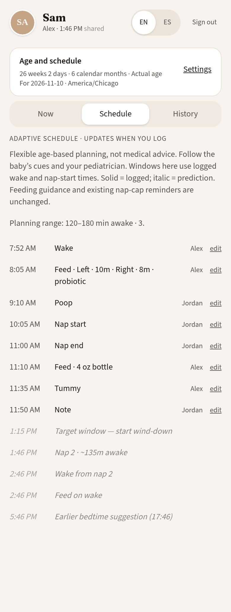
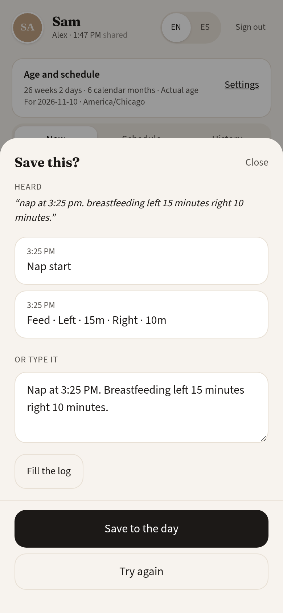
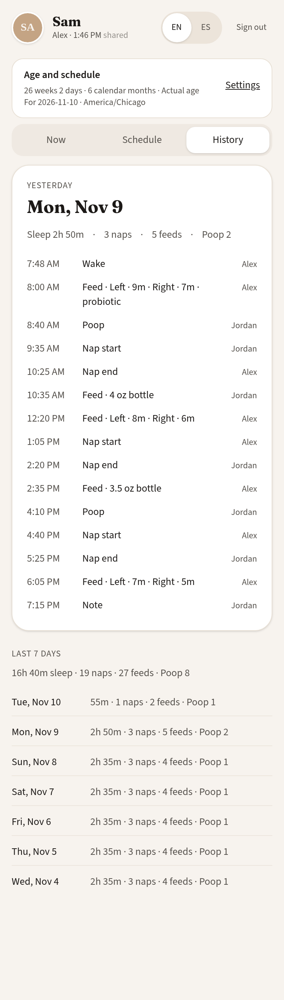
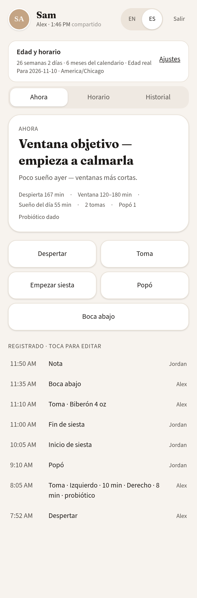

# Shared Care Day

A live daily care tracker for a small household of caregivers. Everyone signs in with an allowlisted email and a shared PIN, then logs wakes, naps, feeds, diapers, and notes on the same day. The schedule flexes when a nap is short or a feed is skipped, instead of locking the household to a rigid clock.


> **Not medical advice.** Shared Care Day is a logging and planning aid. Wake-window ranges are generic approximations, not a clinical or branded program. Follow your pediatrician. Not affiliated with or endorsed by any sleep-training program.

This repository ships with a fictional demo household (child name **Sam**, caregivers at `@example.com`). Put your own details in local config. Do not commit real names, emails, photos, or dates.

## Features

- Shared day log for invited caregivers, with httpOnly session cookies and an email allowlist
- Age-based wake-window planning from generic, commonly published ranges (guidance, not a prescription)
- Live feed of wakes, naps, feeds, diapers, and notes, attributed to the signed-in caregiver
- Browser speech-to-text parser for quick logging (“Nap at 3:25”, “Left 15, right 10”)
- English and Spanish UI
- Installable PWA with offline fallback
- Profile settings for timezone, morning and bedtime targets, and age basis
- JSON day files on disk, with optional Railway volume persistence, plus backup and restore

## Architecture



- **One shared day.** The server owns `day.json` for the household's current date and archives it at rollover. Every caregiver sees the same feed.
- **Engine on the client.** `buildDay()` turns logged events plus the child's age into the current status, next action, and predicted timeline. It is pure and unit-tested.
- **Voice logging.** The browser's speech recognition produces text; `parseCareSpeech()` turns English or Spanish phrases into events and tolerates ASR stutter.
- **Resilience.** The phone keeps a local copy and can push it back with `PUT /api/restore` if a host wipes the disk.

## Stack

- React 19 and TypeScript on Vite 6
- Express 4 API on Node 20+, run with `tsx`
- Tailwind CSS 4
- date-fns
- Railway-ready (`railway.toml`, `Procfile`, `/api/health`)

## Setup

Requirements: Node.js 20 or later.

```bash
git clone <your-fork-or-clone-url> shared-care-day
cd shared-care-day
cp .env.example .env
cp config.example.json config.json
# Edit config.json with your household. Keep real values out of git.
# Set FAMILY_PIN and a long random SESSION_SECRET in .env.
npm install
npm test
npm run dev
```

`npm run dev` starts the API (port 3001) and the Vite client together. Open the URL Vite prints (port 8080 by default). Sign in with any demo email, for example `alex@example.com`, and the `FAMILY_PIN` from your `.env`.

For screenshots, seed a fictional day first: `npm run seed:demo`.

### Scripts

| Command | What it does |
| --- | --- |
| `npm run dev` | API + client with hot reload |
| `npm run typecheck` | `tsc --noEmit` across client, server, and scripts |
| `npm test` | Node test runner over server, engine, parser, PWA, and i18n tests |
| `npm run build` | Production client build into `dist/` |
| `npm start` | Production server (serves `dist/` and the API) |
| `npm run seed:demo` | Writes a fictional demo day into `DATA_DIR` (refuses to overwrite a real one) |

### Configuration

| File / variable | Purpose |
| --- | --- |
| `config.json` | Child name, date of birth or due date, timezone, morning and bedtime targets, caregiver allowlist (`id`, `name`, `email`). Gitignored. Start from `config.example.json`. |
| `CONFIG_PATH` | Optional path to a config file. If unset, the app tries `./config.json`, then `config.example.json`, then the built-in fictional example. |
| `FAMILY_PIN` | Shared PIN required at sign-in. Required in production. |
| `SESSION_SECRET` | Secret used to sign the `care_session` cookie. Required in production. Generate a long random string. |
| `DATA_DIR` | Directory for `day.json`, archives, and `profile.json`. Defaults to `./data` locally. |
| `CORS_ORIGINS` | Optional comma-separated origins allowed to call the API cross-origin. Unset means same-origin only (recommended). |
| `TRUST_PROXY` | Optional Express `trust proxy` value. Defaults to `1` in production, off locally. |

| `APP_TIMEZONE` | Optional IANA zone (for example `America/Chicago`) that overrides `timezone` in `config.json`. |

Timezones: the server rolls the day over at midnight in the configured zone, and the client schedule engine and voice parser use the same zone (DST-aware, via `src/lib/clock.ts`). If no profile has loaded yet, the client falls back to the browser's own zone.

`config.json` and `.env` are gitignored. Only `config.example.json` and `.env.example` (no real values) belong in the repo.

## Deploy on Railway

1. Create a new Railway project from this repo.
2. Railway will build with `npm install && npm run build` and start with `npm start`, as set in `railway.toml`.
3. Attach a persistent volume and set `DATA_DIR` to the mount path so day logs survive deploys.
4. Set `FAMILY_PIN`, `SESSION_SECRET`, and optionally `CONFIG_PATH` (or copy a `config.json` onto the volume).
5. The health check is `GET /api/health`.

The production server refuses to start if `FAMILY_PIN` or `SESSION_SECRET` is missing, and it warns if storage does not look persistent.

## Security

See [SECURITY.md](SECURITY.md) for the threat model and how to report a vulnerability. In short: allowlisted email + shared PIN (constant-time compare, rate limited), signed `HttpOnly`/`SameSite=Lax`/`Secure` session cookie, same-origin CORS, CSP and other security headers in production, and validated event input.

## Screenshots

Captured from the fictional demo household (`npm run seed:demo`, signed in as `alex@example.com`) at a 390×844 mobile viewport. The example child is about six months old so the age-based plan is visible. Never use photos or data of a real child or household.

**Sign-in.** Allowlisted email and a shared family PIN.



**Live day.** Current status, wake-window guidance, and today’s logged events.



**Schedule.** Logged events in solid type, with italic predictions for the rest of the day.



**Voice logging.** Type or dictate a phrase; review parsed events before saving.



**History.** Yesterday’s log and a seven-day summary.



**Spanish.** The same live day after switching the UI to Spanish.



## Testing

`npm test` runs the suite with Node's built-in runner (`tsx --test`). Coverage includes auth and session handling, rate limiting, security headers, event validation, day rollover and restore, the schedule engine's age bands and nap caps, the bilingual voice parser, PWA assets, and i18n key parity. CI (`.github/workflows/ci.yml`) runs typecheck, tests, build, `npm audit`, and a gitleaks scan on every push and pull request.

## Built with Cursor

Shared Care Day was designed and built in [Cursor](https://cursor.com), with AI-assisted development for the React UI, the Express auth and persistence layer, the wake-window engine, tests, and this open-source packaging. Cursor Agent co-authored the family-auth hardening work. The source, tests, and review remain human-owned: every change was read, edited, and verified before it landed.

## Contributing

See [CONTRIBUTING.md](CONTRIBUTING.md).

## License

MIT. Copyright (c) 2026 David Marshall. See [LICENSE](LICENSE).
